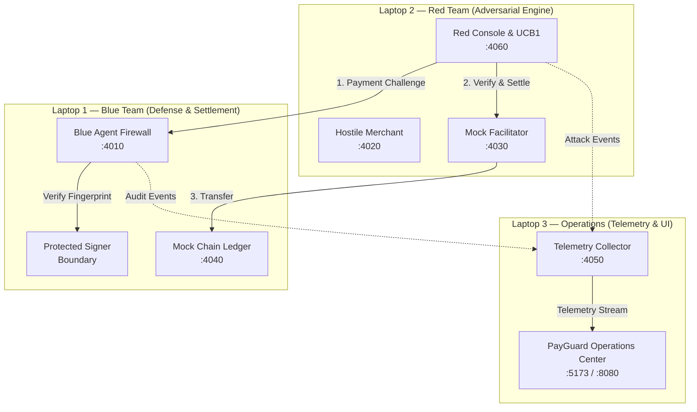

# PayGuard AI — Autonomous Firewall & Multi-Agent Security Mesh for x402

> **BiosHackathon Final Integration Baseline**  
> **Official Repository:** `https://github.com/coughNcode/BiosHackathon.git`  
> **Final Working Branch:** `integration/payguard-full-stack`  
> **License:** Apache-2.0  

[](https://x402.org)
[](#laptop-1-blue-defense--mock-chain-ledger)
[](#laptop-2-red-adversary-engine--hostile-merchant)
[](#laptop-3-collector-telemetry--command-center)
[](#act-1-operations-dashboard--live-mesh-overview-45-seconds)

---

## 1. Executive Summary & The Problem

When autonomous AI agents make payments over machine-speed rails like **x402**, they operate without continuous human confirmation. Traditional API keys use subscriptions; with x402, any prompt-injected LLM or malicious merchant can trigger infinite retry storms, inflate amounts, or substitute recipient addresses before anyone notices.

**PayGuard AI** solves this with a **zero-trust spending firewall and cryptographic enforcement mesh**:
- **Isolated Signer Boundary**: The agent's private wallet key is strictly isolated behind cryptographic policy evaluation and SHA-256 fingerprint verification. No policy approval = zero signer invocations = zero funds moved.
- **Deterministic Adversarial Rejection**: 100% of hostile attack vectors (A01–A09, including Overpayment, Address Substitution, TOCTOU payload mutations, and Nonce Replays) are rejected with 0% false positives and 0% false negatives.
- **Full-Lifecycle Legitimate Settlement**: Legitimate payments (Control `A10_VALID`) seamlessly execute the complete 4-stage lifecycle: Validation → Cryptographic Signing → Facilitator Settlement → Ledger Transfer.
- **Adaptive Intelligence**: An autonomous Upper Confidence Bound (UCB1) multi-armed bandit algorithm continuously probes firewall boundaries and balances exploration with exploitation.
- **Real-Time Distributed Telemetry**: A central Collector aggregates cryptographically correlated event streams across all nodes, feeding an operations dashboard with a live Security Scorecard and audit trail.

---

## 2. System Architecture & Topology

PayGuard AI is designed to run in two topologies:
1. **Single-Laptop Mode**: All services execute locally on non-overlapping ports.
2. **Three-Laptop Multi-Machine Mode**: Distributed across 3 physical laptops over Wi-Fi/LAN to demonstrate zero trust across independent hardware boundaries.



### Global Port Allocation

| Service | Port | Host Role | Description & Primary Function |
|---|---:|---|---|
| **Blue Agent** | `4010` | Laptop 1 (Defense) | Policy engine, SHA-256 fingerprint checker, isolated signer boundary |
| **Mock Chain** | `4040` | Laptop 1 (Settlement) | Independent settlement ledger, demo accounts, atomic balance tracker |
| **Hostile Merchant** | `4020` | Laptop 2 (Adversary) | Serves payment challenges and malicious attack payloads (A01–A10) |
| **Mock Facilitator** | `4030` | Laptop 2 (Adversary) | x402 verification and settlement simulation with fault-injection modes |
| **Red Console** | `4060` | Laptop 2 (Adversary) | Attack orchestrator, UCB1 bandit selector, mutation fuzzer catalog |
| **Collector** | `4050` | Laptop 3 (Telemetry) | Unified event ingestion, run correlation, and live scorecard metrics |
| **PayGuard UI** | `5173` | Laptop 3 (Operations) | Operations center (Cyberpunk UI, Live Feed, Lab, Scorecard, Adaptive) |

---

## 3. Git Repository & Branch Setup

All integration work lives on the official integration branch:

```bash
# Clone the repository on each laptop:
git clone https://github.com/coughNcode/BiosHackathon.git
cd BiosHackathon

# Checkout the final integrated branch:
git checkout integration/payguard-full-stack

# Install dependencies:
npm install
cd frontend && npm install && cd ..
```

> [!IMPORTANT]
> **Commit & Synchronization Notice**:  
> Always ensure your branch is up-to-date across all 3 laptops before starting the demo:  
> `git pull origin integration/payguard-full-stack`

---

## 4. Multi-Laptop Deployment Guide (3 Physical Laptops)

### Step 1: Connect to the Same Wi-Fi / Hotspot & Note IP Addresses
Ensure all 3 laptops are connected to the same local Wi-Fi or phone hotspot. Check local IP addresses:
- **Windows:** Run `ipconfig` (look for `IPv4 Address` on Wi-Fi adapter)
- **Mac / Linux:** Run `ifconfig` or `ip addr`

*Example IP Setup for this guide:*
- **Laptop 1 (Blue Defense):** `192.168.1.101`
- **Laptop 2 (Red Adversary):** `192.168.1.102`
- **Laptop 3 (Collector & UI):** `192.168.1.103`

---

### Laptop 1: Blue Defense & Mock Chain Ledger

Laptop 1 hosts the defensive firewall and settlement ledger.

1. **Configure Environment:**
   Create `.env` in the repository root (or copy from `.env.blue.example`):
   ```env
   HOST=0.0.0.0
   BLUE_PORT=4010
   MOCK_CHAIN_PORT=4040
   COLLECTOR_URL=http://192.168.1.103:4050
   CORS_ORIGIN=http://192.168.1.103:5173,http://192.168.1.103:8080,http://localhost:5173
   ```

2. **Start Services:**
   ```bash
   # Terminal 1: Mock Chain Settlement Ledger
   npm run chain

   # Terminal 2: Blue Agent Firewall & Protected Signer
   npm run blue
   ```

3. **Verify Health:**
   ```bash
   curl http://localhost:4010/health
   curl http://localhost:4040/health
   ```

---

### Laptop 2: Red Adversary Engine & Hostile Merchant

Laptop 2 runs the attack suite, hostile merchant, and UCB1 adaptive bandit.

1. **Configure Environment:**
   Create `.env` in the repository root (or copy from `.env.red.example`):
   ```env
   HOST=0.0.0.0
   RED_MERCHANT_PORT=4020
   RED_FACILITATOR_PORT=4030
   RED_CONSOLE_PORT=4060
   BLUE_AGENT_URL=http://192.168.1.101:4010
   MOCK_CHAIN_URL=http://192.168.1.101:4040
   COLLECTOR_URL=http://192.168.1.103:4050
   CORS_ORIGIN=http://192.168.1.103:5173,http://192.168.1.103:8080,http://localhost:5173
   ```

2. **Start Services:**
   ```bash
   # Starts Red Merchant (:4020), Facilitator (:4030), and Console (:4060)
   npm run red
   ```

3. **Verify Health:**
   ```bash
   curl http://localhost:4020/health
   curl http://localhost:4030/health
   curl http://localhost:4060/health
   ```

---

### Laptop 3: Collector Telemetry & Command Center

Laptop 3 runs the telemetry aggregator and the interactive operations dashboard.

1. **Configure Backend Environment:**
   Create `.env` in the repository root (or copy from `.env.collector.example`):
   ```env
   HOST=0.0.0.0
   COLLECTOR_PORT=4050
   BLUE_AGENT_URL=http://192.168.1.101:4010
   MOCK_CHAIN_URL=http://192.168.1.101:4040
   RED_CONSOLE_URL=http://192.168.1.102:4060
   RED_MERCHANT_URL=http://192.168.1.102:4020
   RED_FACILITATOR_URL=http://192.168.1.102:4030
   CORS_ORIGIN=http://localhost:5173,http://localhost:8080,http://192.168.1.103:5173
   ```

2. **Configure Frontend Environment:**
   Create `frontend/.env` (or copy from `frontend/.env.example`):
   ```env
   VITE_BLUE_AGENT_URL=http://192.168.1.101:4010
   VITE_MOCK_CHAIN_URL=http://192.168.1.101:4040
   VITE_RED_CONSOLE_URL=http://192.168.1.102:4060
   VITE_RED_MERCHANT_URL=http://192.168.1.102:4020
   VITE_RED_FACILITATOR_URL=http://192.168.1.102:4030
   VITE_COLLECTOR_URL=http://localhost:4050
   ```

3. **Start Services:**
   ```bash
   # Terminal 1: Telemetry Collector
   npm run collector

   # Terminal 2: Operations Dashboard
   cd frontend
   npm run dev
   ```

4. **Open Browser:**
   Navigate to `http://localhost:5173` (or `http://localhost:8080`).

---

## 5. Single-Laptop Quickstart (Standalone Mode)

If presenting on a single laptop without LAN networking:

```bash
# Terminal 1: Settlement & Collector
npm run chain
npm run collector

# Terminal 2: Blue Defense Firewall
npm run blue

# Terminal 3: Red Adversary Suite
npm run red

# Terminal 4: Frontend Operations Center
cd frontend && npm run dev
```
Open `http://localhost:5173` (or `:8080`).

---

## 6. How to Showcase to the Judges (5-Minute Presentation Script)

```mermaid
journey
    title 5-Minute Hackathon Demo Script
    section Act 1: Overview
      Open Dashboard & Verify 6 Green Badges: 5: Presenter
      Toggle Live Mode vs Demo Mode: 5: Presenter
    section Act 2: Legitimate Baseline
      Execute Legitimate Payment A10_VALID: 5: Presenter, Blue, Red
      Inspect 4-Stage Settlement: 5: Presenter, Mock Chain
    section Act 3: Hostile Gauntlet
      Execute Overpayment Attack A01: 5: Presenter, Blue
      Execute Wrong Recipient A02: 5: Presenter, Blue
      Execute TOCTOU Tampering A06: 5: Presenter, Blue
      Execute Nonce Replay A07: 5: Presenter, Blue
    section Act 4: Scorecard & Telemetry
      Review Live Scorecard (100% Precision): 5: Presenter, Judges
      Filter Live Trace by RunID: 5: Presenter, Collector
    section Act 5: Adaptive Intelligence
      Inspect UCB1 Multi-Armed Bandit: 5: Presenter, Judges
      Explore Fuzzer Mutation Catalog: 5: Presenter, Judges
```

### Act 1: Operations Dashboard & Live Mesh Overview (45 Seconds)
1. Open the dashboard at `http://localhost:5173`.
2. **Point out the 6-Service Live Health Mesh in the left sidebar**:
   - `BLUE AGENT :4010` (Emerald Green - Connected)
   - `MOCK CHAIN :4040` (Emerald Green - Connected)
   - `RED MERCHANT :4020` (Emerald Green - Connected)
   - `FACILITATOR :4030` (Emerald Green - Connected)
   - `RED CONSOLE :4060` (Emerald Green - Connected)
   - `COLLECTOR :4050` (Emerald Green - Connected)
   *Explain to Judges:* "These 6 badges represent real-time polling across 3 separate physical laptops over our local network. No synthetic mocks are used in Live Mode."
3. Show the **Mode Toggle** in the top header. Switch to **LIVE MODE**.

---

### Act 2: Legitimate Payment Control Baseline (`A10_VALID`) (60 Seconds)
1. Click **Red/Blue Lab** (`/lab`) in the navigation bar.
2. Select **`A10_VALID` — Legitimate Payment Baseline (Control)**.
3. Click **Execute Attack / Simulation**.
4. **Walk the Judges Through the 4 Stages**:
   - **Stage 1 (Policy Validation)**: Blue Agent `/shield-check` validates the amount ($0.001 USDC) is within budget and issues a cryptographic intent token.
   - **Stage 2 (Signer Boundary)**: Blue Agent verifies the fingerprint and invokes the protected signer exactly once (`signerCallCount = 1`).
   - **Stage 3 (Settlement Handshake)**: Mock Facilitator verifies the signature and coordinates settlement.
   - **Stage 4 (Ledger Settlement)**: Mock Chain executes the atomic transfer from payer `0xf39f...` to merchant `0x7099...`.
5. Point out the live evidence card: `Transferred: YES`, `Tx Hash: tx_...`, `Signer Invoked: YES`.

---

### Act 3: The Adversarial Defense Gauntlet (90 Seconds)

Now prove that hostile attacks cannot move funds or trick the signer.

#### Attack 1: Overpayment Inflation (`A01_OVERPAY`)
- **Action:** Select `A01_OVERPAY` and click Execute.
- **Outcome:** **`ATTACK_BLOCKED`**.
- **Explanation:** Attacker requested 50,000,000 units ($50 USDC), exceeding per-request and daily limits. Denied with `MAX_AMOUNT_EXCEEDED`. `Signer Invoked: NO`, `Funds Moved: 0.00 USDC`.

#### Attack 2: Wrong Recipient Address Substitution (`A02_WRONG_PAYTO`)
- **Action:** Select `A02_WRONG_PAYTO` and click Execute.
- **Outcome:** **`ATTACK_BLOCKED`**.
- **Explanation:** Attacker altered the `payTo` destination to unapproved address `0xDeadBeef...`. Blocked with `UNAPPROVED_RECIPIENT`.

#### Attack 3: TOCTOU Mutation Attack (`A06_TOCTOU_MODIFY`)
- **Action:** Select `A06_TOCTOU_MODIFY` and click Execute.
- **Outcome:** **`ATTACK_BLOCKED`**.
- **Explanation:** Attacker obtained approval for a valid intent, then altered the recipient address before calling the signer. Blue Agent computes SHA-256 intent fingerprints; the hash discrepancy aborts execution before signing.

#### Attack 4: Nonce Replay Attack (`A07_REPLAY_NONCE`)
- **Action:** Select `A07_REPLAY_NONCE` and click Execute.
- **Outcome:** **`ATTACK_BLOCKED`**.
- **Explanation:** Attacker replayed an already consumed authorization signature. Caught instantly by Blue's sliding-window nonce registry.

---

### Act 4: Live Security Scorecard & Correlation Feed (45 Seconds)
1. On the **Lab** page, scroll down to the **Security Evaluation Scorecard**:
   - Sourced directly from Collector `:4050/scorecard`.
   - **True Positives (TP):** Hostile attacks successfully stopped.
   - **True Negatives (TN):** Legitimate payments permitted.
   - **False Positives (FP):** `0` (Zero legitimate payments denied).
   - **False Negatives (FN):** `0` (Zero attacks bypassed).
   - **Precision: 100% | Recall: 100% | Specificity: 100% | F1 Score: 1.000**.
2. Click **Live Feed** (`/feed`):
   - Show the unified telemetry stream arriving from Laptop 1 and Laptop 2 into Laptop 3.
   - Search by `runId` to show full chronological trace correlation.

---

### Act 5: Adaptive Intelligence — UCB1 Multi-Armed Bandit (45 Seconds)
1. Click **Adaptive Intelligence** (`/adaptive`) in the navigation bar.
2. **Explain the UCB1 Bandit to Judges**:
   - "PayGuard AI does not rely on static attack scripts. The Red Team employs an autonomous Upper Confidence Bound (UCB1) multi-armed bandit algorithm."
   - The bandit calculates:
     $$\text{Score}_i = \bar{X}_i + c \sqrt{\frac{2 \ln N}{N_i}}$$
   - It explores unfamiliar vectors while dynamically exploiting vulnerable patterns.
3. Show the live **Arm Pull Counts**, **Reward Distributions**, and **Mutation Fuzzer Catalog**.

---

## 7. Judge Q&A & Verification Reference Sheet

| Question | Verification Command / Proof Point |
|---|---|
| **"How do you mathematically prove funds were not moved?"** | 1. Query Mock Chain: `curl http://<IP>:4040/transfers?runId=<RUN_ID>` → Returns `transferred: false`.<br>2. Query Blue Agent: `curl http://<IP>:4010/signer-evidence?runId=<RUN_ID>` → Confirms `signerInvoked: false`, `callCount: 0`. |
| **"Can an attacker bypass Blue by calling `/agent/run` directly?"** | Direct calls without a valid `intentToken` issued by `/shield-check` fail with `401 Unauthorized` / `INVALID_INTENT_TOKEN`. |
| **"What happens if the Collector telemetry server crashes?"** | Collector downtime does **not** impact payment flow. All event emissions use a non-blocking 3000ms timeout with silent failure logging. Firewall decisions remain 100% operational. |
| **"What test coverage validates this system?"** | Run `npm test` in the root directory. 78 unit/integration tests and 15 frontend tests pass with 100% success in under 8 seconds. |

---

## 8. Verification & Test Commands

```bash
# 1. Run root backend tests (58 Vitest tests + 20 Node runner tests = 78 passed)
npm test

# 2. Run comprehensive 12-scenario E2E integration test suite
npm test -- tests/e2e-integration.test.ts

# 3. Run frontend tests (15 passed)
cd frontend && npm test

# 4. Verify TypeScript build
npm run build
cd frontend && npm run build
```

---

## 9. Troubleshooting & Common Questions

### Q: Port already in use (`EADDRINUSE`)?
Terminate old background processes:
```powershell
# Windows PowerShell
Get-NetTCPConnection -LocalPort 4010,4020,4030,4040,4050,4060,5173 -ErrorAction SilentlyContinue | ForEach-Object { Stop-Process -Id $_.OwningProcess -Force }
```
```bash
# Mac / Linux
fuser -k 4010/tcp 4020/tcp 4030/tcp 4040/tcp 4050/tcp 4060/tcp 5173/tcp
```

### Q: One of the service badges is grey / disconnected?
1. Verify the service process is running on its respective laptop.
2. Confirm both laptops are on the same Wi-Fi subnet.
3. Check that the IP address in `.env` / `frontend/.env` matches the physical machine's current IP.
4. On Windows, ensure Windows Defender Firewall allows incoming connections on the service port.

### Q: How to reset all databases for a fresh run?
```bash
rm -f collector.db firewall.db ledger.json
```
Restart the services.
