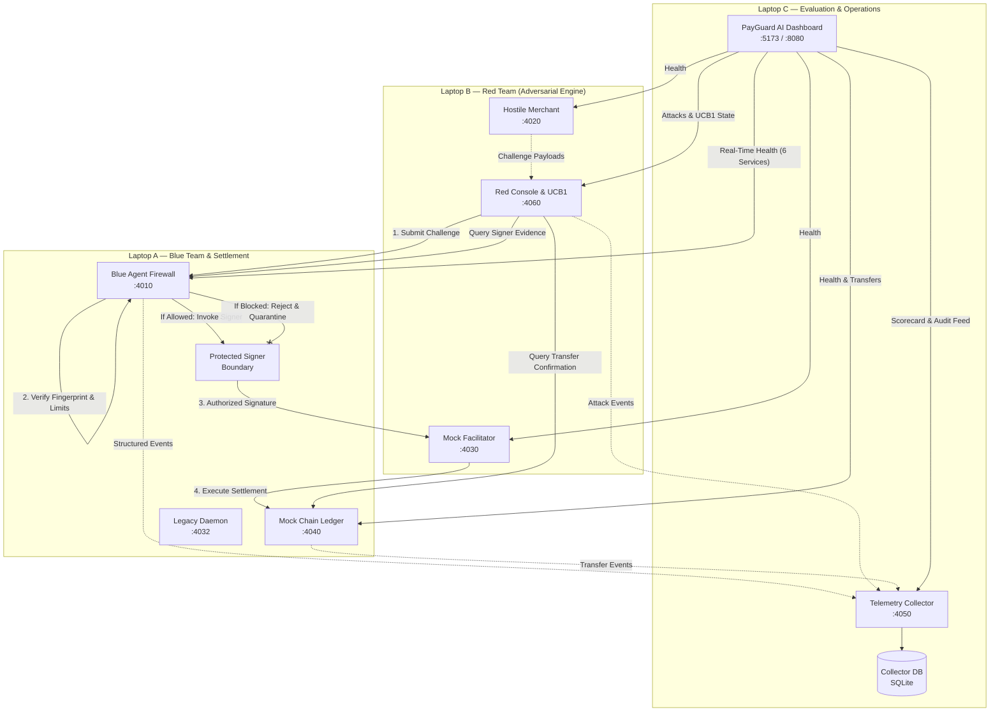
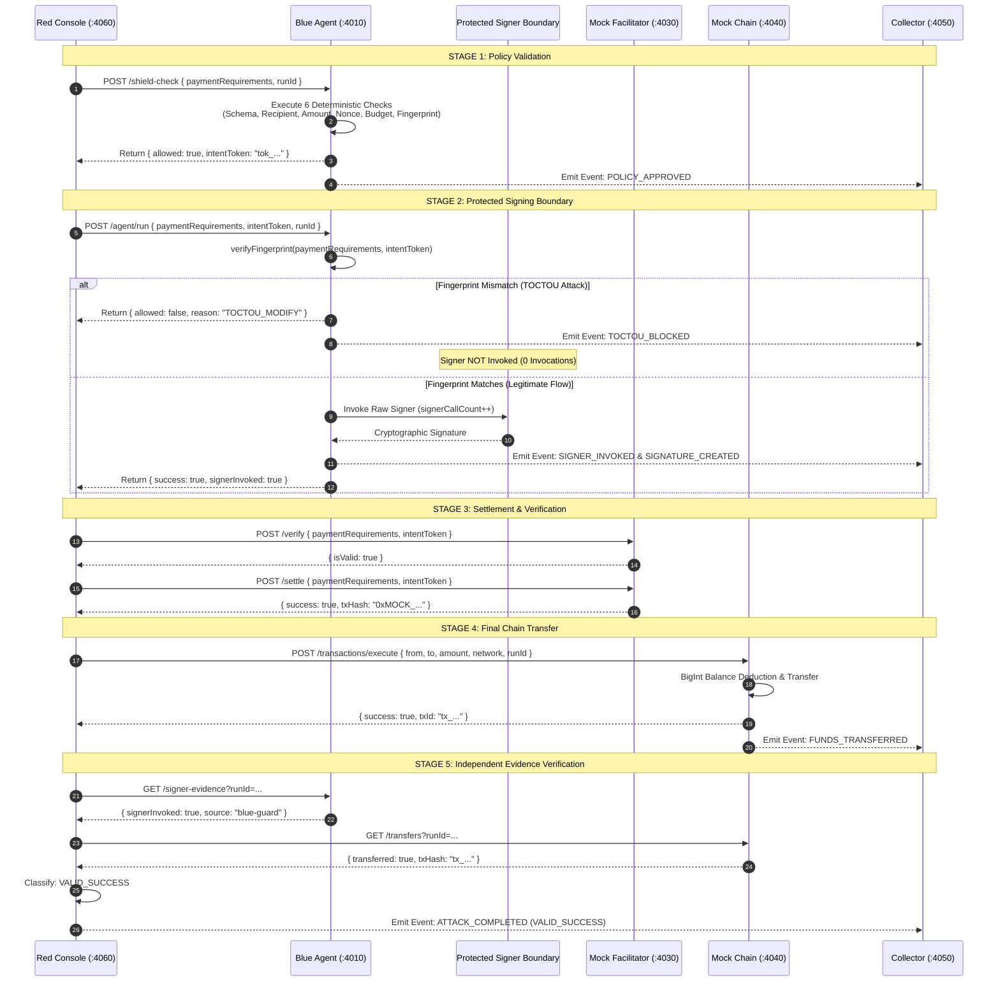

# PayGuard AI — Full-Stack System Architecture & Integration Specification

**Version:** 1.0.0 (Production Hackathon Baseline)  
**Branch:** `integration/payguard-full-stack`  
**License:** Apache 2.0  
**Authors:** PayGuard AI Core Engineering Team  

---

## 1. Executive Summary

PayGuard AI is an autonomous, deterministic security firewall and evaluation framework for agentic x402 payment rails. The architecture cleanly decouples defense (Blue Agent), offensive vulnerability exploration (Red Team Engine), multi-party telemetry aggregation (Collector), and the settlement ledger (Mock Chain). The frontend provides a high-density, real-time command-and-control operations center built with React, Vite, and TanStack Start.

The system is designed for dual deployment:
1. **Single-Machine Mode**: All 8 services bind to `0.0.0.0` or `localhost` across dedicated non-overlapping ports.
2. **Three-Laptop Hackathon Mode**: Services run distributed across three distinct physical laptops connected over local Wi-Fi / Ethernet LAN, maintaining zero trust and strict boundary enforcement.

---

## 2. Global Port Mapping & Service Responsibilities

| Service Name | Port | Host Role | Description & Core Endpoints |
|---|---:|---|---|
| **Blue Agent** | `4010` | Laptop A (Defense) | Firewall inspection engine, provider registry, fingerprint verification, signer isolation.<br>`GET /health`<br>`POST /shield-check`<br>`POST /agent/run`<br>`GET /signer-evidence`<br>`GET /policy`<br>`GET /metrics`<br>`GET /providers`<br>`GET /audit-log` |
| **Mock Chain** | `4040` | Laptop A (Settlement) | Independent settlement ledger, demo accounts, atomic USDC balances, transaction history.<br>`GET /health`<br>`GET /ledger`<br>`GET /transactions`<br>`GET /transfers`<br>`POST /transactions/execute`<br>`POST /balances/reset` |
| **Legacy Wallet Daemon** | `4032` | Laptop A (Legacy) | Original x402 wallet daemon for legacy EVM/Solana agent clients.<br>`GET /health`<br>`GET /ledger`<br>`POST /policy/evaluate` |
| **Hostile Merchant** | `4020` | Laptop B (Offense) | Serves payment challenges, malicious scenario payloads (A01–A10), and 402 responses.<br>`GET /health`<br>`GET /scenarios`<br>`GET /payment-required`<br>`POST /payment-required`<br>`POST /mode` |
| **Mock Facilitator** | `4030` | Laptop B (Offense) | x402 verification & settlement stub with fault-injection modes (`normal`, `fail_verify`, `fail_settle`, `timeout`, `malformed`).<br>`GET /health`<br>`GET /supported`<br>`POST /verify`<br>`POST /settle`<br>`POST /mode` |
| **Red Console** | `4060` | Laptop B (Offense) | Attack orchestrator, UCB1 adaptive bandit selector, mutation fuzzer catalog.<br>`GET /health`<br>`GET /attacks`<br>`POST /redblue/run`<br>`GET /redblue/result/:runId`<br>`GET /redblue/history`<br>`GET /ucb1/state`<br>`GET /fuzzer/catalog` |
| **Collector** | `4050` | Laptop C (Telemetry) | Unified event ingestion, run correlation, SQLite persistence, and security scorecard.<br>`GET /health`<br>`POST /events`<br>`GET /events`<br>`GET /runs`<br>`GET /runs/:runId`<br>`GET /metrics`<br>`GET /scorecard`<br>`GET /audit-log` |
| **Frontend Dashboard** | `5173` | Laptop C (Operator) | Operations center (Cyberpunk dark/light UI), 6-service connection health panel, Live Feed, Attack Lab, Risk Analytics, Policy Editor, Payment Inspector, Adaptive Bandit.<br>`http://localhost:5173` (or `:8080`) |

---

## 3. High-Level Architecture Diagram



---

## 4. Multi-Laptop Hardware & Network Topology (Hackathon 3-Laptop Setup)

In an on-stage presentation or multi-machine hackathon environment, the three laptops connect to the same local Wi-Fi router or switch.

```
                    ┌───────────────────────────┐
                    │  Local Wi-Fi / Switch     │
                    │  Subnet: 192.168.1.0/24   │
                    └─────────────┬─────────────┘
                                  │
         ┌────────────────────────┼────────────────────────┐
         │                        │                        │
         ▼                        ▼                        ▼
┌──────────────────┐    ┌──────────────────┐    ┌──────────────────┐
│     LAPTOP A     │    │     LAPTOP B     │    │     LAPTOP C     │
│   Blue + Chain   │    │  Red Team Engine │    │ Collector + UI   │
│  192.168.1.101   │    │  192.168.1.102   │    │  192.168.1.103   │
│                  │    │                  │    │                  │
│ • Blue (:4010)   │    │ • Merchant(:4020)│    │ • Collector(:4050│
│ • MockChain(4040)│    │ • Facilitator(403│    │ • Frontend(:5173)│
│ • Legacy (:4032) │    │ • Console (:4060)│    │                  │
└──────────────────┘    └──────────────────┘    └──────────────────┘
```

### Laptop A Configuration (Defense & Settlement)
Create `.env` on Laptop A (copied from `.env.blue.example`):
```bash
HOST=0.0.0.0
BLUE_PORT=4010
MOCK_CHAIN_PORT=4040
MOCK_CHAIN_URL=http://localhost:4040
COLLECTOR_URL=http://192.168.1.103:4050
ADMIN_KEY=dev-admin-key
SIGNING_SECRET=payguard-hmac-sha256-signing-secret
CORS_ORIGINS=http://localhost:5173,http://localhost:8080,http://192.168.1.103:5173,http://192.168.1.103:8080
```
**Start command:**
```bash
npm run blue & npm run chain
```

### Laptop B Configuration (Offense & Attacks)
Create `.env` on Laptop B (copied from `.env.red.example`):
```bash
HOST=0.0.0.0
MERCHANT_PORT=4020
FACILITATOR_PORT=4030
RED_CONSOLE_PORT=4060
BLUE_URL=http://192.168.1.101:4010
MOCK_CHAIN_URL=http://192.168.1.101:4040
COLLECTOR_URL=http://192.168.1.103:4050
BLUE_ADMIN_KEY=dev-admin-key
CORS_ORIGINS=http://localhost:5173,http://localhost:8080,http://192.168.1.103:5173,http://192.168.1.103:8080
```
**Start command:**
```bash
npm run red
```

### Laptop C Configuration (Evaluation & Operations Dashboard)
Create root `.env` and `frontend/.env` on Laptop C:
**Root `.env`:**
```bash
HOST=0.0.0.0
COLLECTOR_PORT=4050
DB_FILE=./data/payguard-collector.db
BLUE_URL=http://192.168.1.101:4010
RED_URL=http://192.168.1.102:4060
MOCK_CHAIN_URL=http://192.168.1.101:4040
CORS_ORIGINS=http://localhost:5173,http://localhost:8080,http://192.168.1.103:5173,http://192.168.1.103:8080
ADMIN_KEY=dev-admin-key
```
**`frontend/.env`:**
```bash
VITE_MOCK_API=false
VITE_BLUE_URL=http://192.168.1.101:4010
VITE_RED_URL=http://192.168.1.102:4060
VITE_COLLECTOR_URL=http://localhost:4050
VITE_MOCK_CHAIN_URL=http://192.168.1.101:4040
VITE_MERCHANT_URL=http://192.168.1.102:4020
VITE_FACILITATOR_URL=http://192.168.1.102:4030
```
**Start commands:**
```bash
# Terminal 1: Collector
npm run collector

# Terminal 2: Frontend
npm run dev
```

---

## 5. Security Decision & Signing Boundary Architecture

A critical architectural invariant is the **strict isolation between policy approval, cryptographic signing, and ledger settlement**.



---

## 6. Event Schema & Non-Blocking Resilience

All events emitted to the Collector strictly conform to the shared contract:

```typescript
interface CollectorEventInput {
  eventId?: string;         // Unique event UUID
  timestamp: string;        // ISO 8601
  runId?: string;           // Correlated run identifier (run_...)
  attackId?: string;        // Scenario identifier (A01_OVERPAY ... A10_VALID)
  source: "BLUE" | "RED" | "CHAIN" | "COLLECTOR" | "DEMO";
  eventType: string;        // Standardized event taxonomy
  severity: "INFO" | "LOW" | "MEDIUM" | "HIGH" | "CRITICAL";
  message: string;          // Human-readable audit text
  data?: Record<string, unknown>; // Contextual metadata (never credentials)
}
```

### Non-Blocking Fail-Safe Guarantee
- If the Collector service goes offline or experiences network degradation, event emissions via `emitEvent()` timeout in 3000ms and are dropped cleanly.
- Under NO circumstance does a collector failure alter a security verdict or permit an unauthorized transaction to pass through the signing boundary. Security checks fail closed; logging fails open.
